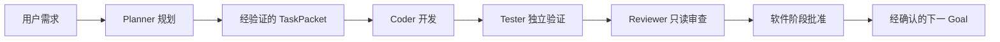

# AI Project Factory (APF)

用自然语言描述软件需求，让 Planner、Coder、Tester 和 Reviewer 协作完成规划、开发、验证与阶段交付。

APF 面向希望降低软件开发门槛的用户。目前专注 **个人 Windows 电脑与 Codex**，已完成受控双阶段软件开发的真实验证；使用仍需要环境准备、权限选择和阶段范围确认，尚不能无人干预完成任意软件。

## 当前进度

**APF Goal 0～Goal 3 已批准，其中 Goal 2 和 Goal 3 为限定范围批准。**

| APF 里程碑 | 已批准范围 | Tag |
| --- | --- | --- |
| Goal 0 | 三个可复用 Skills、模板与两类规划案例 | `goal-0-approved` |
| Goal 1 | Planner → TaskPacket → Coder、基础验证与失败恢复 | `goal-1-approved` |
| Goal 2 | 独立质量角色、缺陷包、有限返工及恢复；有限范围外部审查 | `goal-2-approved` |
| Goal 3 | 同一待办软件从已批准 Goal 0 接续到 Goal 1，真实编码、测试、只读审查与阶段批准 | `goal-3-approved` |

**APF 的 Goal 是工厂能力里程碑；生成软件的 Goal 是该软件的实施阶段。** 两者不是同一套进度。

## 核心流程



主控保存状态、任务包和证据；Tester 合法通过后才能进入 Reviewer。明确业务缺陷可以生成 DefectPacket 并进入受控修复；**真实 CoderRepair 自动返工完整闭环仍未验证**。当前流程不包含自动 Git 封版或软件发行。

## 已验证案例：本机离线待办工具

| 软件阶段 | 交付功能 | 真实质量结果 |
| --- | --- | --- |
| Goal 0 | 新增、查看、删除、本地持久化 | 真实 Tester 证据复核与独立只读 Reviewer 批准 |
| Goal 1 | 编辑标题、完成状态、三类筛选、旧数据兼容，保留前阶段核心能力 | 独立 TaskPacket、新候选、真实 Coder/Tester/Reviewer 与正式阶段回执 |

已执行实际构建、业务操作、持久化与失败场景检查，以及 Windows Edge 桌面和移动视口交互验证。移动视口模拟不等于真机测试，截图和重复检查不作为独立测试数量。软件 Goal 1 接续复用了原 Planner 的合法规划，没有重新开发 Goal 0。

## 能力边界

| 能力 | 当前状态 |
| --- | --- |
| 需求规划、任务包校验、真实编码、基础构建/运行检查 | 已实现并有真实执行证据 |
| 独立 Tester 与只读 Reviewer | 已实现；待办案例取得真实质量批准 |
| 固定候选、证据哈希、完成记录复用与两阶段串行接续 | 已实现；受控案例真实验证 |
| 缺陷包、有限返工、部分中断恢复 | 已实现并有确定性测试；真实自动返工闭环未验证 |
| 无人干预的任意多 Goal 连续开发 | 未实现 |
| 自动 Git 管理、最终安装包与发行 | 未实现，分别属于后续 Goal 4、Goal 5 |
| OS 级工作区隔离、Token 硬限制 | 当前不提供 |
| 普通用户零配置、一键软件工厂 | 未来方向；独立 CLI 0.1.0 尚未合并主线 |

## 安装与运行

主线使用源码和 PowerShell 入口，没有正式发布的安装包。准备 Windows 11、PowerShell、Python 3.11+，以及已安装并登录的可信 Codex CLI。生成 Web 项目还需要相应 Node/Edge/浏览器工具环境；换机真实执行尚未完整验证。

获取源码后在**仓库根目录**运行：

```powershell
git clone https://github.com/kaleidoscopezzz/AI-Project-Factory.git
Set-Location AI-Project-Factory
python --version
$cli = Read-Host '请输入已安装且可信的 codex.exe 路径'
.\scripts\factory.ps1 -CheckCli -CodexPath $cli
```

`CheckCli` 只核对程序路径和版本，不调用模型，也不证明已登录或浏览器可用。以下命令会调用真实 Agent、消耗 Token；`-FullAccess` 是调用者对本次执行的明确权限选择：

```powershell
.\scripts\factory.ps1 -Request "开发一个 Windows 本机离线待办工具，先实现新增、查看、删除和本地持久化" -Mode Auto -QualityGate -NoAutoRepair -FullAccess -CodexPath $cli -TimeoutSeconds 600
```

这是当前单阶段入口，**不会自动完成任意后续 Goal**。受控两阶段能力使用开发 API，详见 [Goal 3 阶段机制](docs/GOAL3_INCREMENT.md)。新需求 Full Access 入口有确定性控制测试；不要将上述新命令描述为已经在每种环境完成真实 E2E。

开发 APF 本身可执行不派发模型的回归：

```powershell
python -B -m unittest discover -s tests -p 'test_*.py'
```

完整环境要求、查询/恢复和参数说明见 [快速开始](docs/GOAL1_USAGE.md)。当前部分浏览器工具配置及历史守护具有开发环境依赖，仍需要技术核对，不能视为零配置安装。

## 技术架构

Python Controller 管理任务、状态与调用；Codex CLI 执行角色；TaskPacket 绑定需求、权限和输入；QualityGate 核对候选与独立质量结果；Sequence 管理同一软件的两阶段记录。状态、日志、测试证据和阶段回执保存在项目控制目录中。详见 [架构说明](docs/ARCHITECTURE.md)。

## 下一步与限制

正式路线图下一阶段为 **Goal 4：受控 Git Agent 与外部验收/冻结账本**；Goal 5 为 Release Agent 与发行交付，两者尚未开发。面向普通用户的一键体验可作为建议 Goal 6，尚未纳入已批准的原始路线图。

Full Access 使用当前用户的文件、进程和网络权限，**不是 OS 级工作区沙箱**。真实调用可能消耗大量 Token，目前没有可靠硬上限。APF 仍在持续开发，重大歧义、权限和不可安全恢复的问题需要用户介入。

## 文档导航

- [快速开始与 Windows 运行](docs/GOAL1_USAGE.md)
- [Skills 使用与可选安装](docs/USAGE.md)
- [技术架构](docs/ARCHITECTURE.md)
- [正式路线图及建议扩展](docs/MULTI_AGENT_ROADMAP.md)
- [项目状态与历史](PROJECT_STATUS.md)
- [已验证能力、案例与已知限制](docs/VERIFIED_CAPABILITIES.md)
- [Goal 3 批准范围与开发 API](docs/GOAL3_INCREMENT.md)
- [独立质量验证](docs/GOAL2_USAGE.md)
