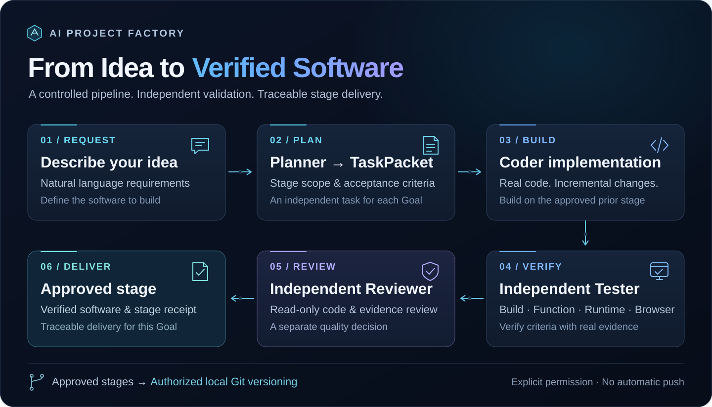

# AI Project Factory (APF)

用自然语言描述软件需求，让 Planner、Coder、Tester 和 Reviewer 协作完成规划、开发与阶段批准，再通过受控 Git 和 Release Agent 留下版本、交付可运行的软件。

APF 面向希望降低软件开发门槛的用户。目前专注 **个人 Windows 电脑与 Codex**，已验证受控双阶段开发、独立质量审查、授权本地 Git 版本管理和真实本地 ZIP 发行。使用仍需要环境准备、权限选择和阶段范围确认，尚不能无人干预完成任意软件。

## 当前进度

**APF 1.0.0 按受控两阶段范围发布；原始 Goal 0～Goal 5 已按各自批准范围封版。** Goal 2 为有限范围批准，Goal 3 为受控双阶段批准，Goal 4 限于授权本地版本管理，Goal 5 为有限范围本地软件发行批准。

| APF 里程碑 | 已批准范围 | Tag |
| --- | --- | --- |
| Goal 0 | 三个可复用 Skills、模板与两类规划案例 | `goal-0-approved` |
| Goal 1 | Planner → TaskPacket → Coder、基础验证与失败恢复 | `goal-1-approved` |
| Goal 2 | 独立质量角色、缺陷包、有限返工及恢复；有限范围外部审查 | `goal-2-approved` |
| Goal 3 | 同一待办软件从已批准 Goal 0 接续到 Goal 1，真实编码、测试、只读审查与阶段批准 | `goal-3-approved` |
| Goal 4 | 项目策略授权的本地 Git Commit、候选与批准来源绑定；不自动 Tag/Push | `goal-4-approved` |
| Goal 5 | Release Agent 构建、ZIP 检查、独立解压运行与交付记录；有限范围本地发行 | `goal-5-approved` |

**APF 的 Goal 是工厂能力里程碑；生成软件的 Goal 是该软件的实施阶段。** 两者不是同一套进度。

## 核心流程



APF 已真实验证受控双阶段开发、独立 Tester、只读 Reviewer 及正式阶段交付。批准后，通过明确授权的阶段后接口生成本地 Git 版本，再由 Release Agent 在独立副本中构建、检查 ZIP、解压并实际启动，记录发行来源、SHA-256 和交付结果。两者不需要额外模型调用，也不自动 Push 或上传。

接口与权限见 [受控本地 Git](docs/GOAL4_USAGE.md) 和 [本地软件发行](docs/GOAL5_USAGE.md)。**真实 CoderRepair 自动返工闭环与完整无人值守多 Goal 交付仍未验证。**

## 已验证案例：原 Goal 3 待办工具（历史已批准）

| 软件阶段 | 交付功能 | 真实质量结果 |
| --- | --- | --- |
| Goal 0 | 新增、查看、删除、本地持久化 | 真实 Tester 证据复核与独立只读 Reviewer 批准 |
| Goal 1 | 编辑标题、完成状态、三类筛选、旧数据兼容，保留前阶段核心能力 | 独立 TaskPacket、新候选、真实 Coder/Tester/Reviewer 与正式阶段回执 |

已执行实际构建、业务操作、持久化与失败场景检查，以及 Windows Edge 桌面和移动视口交互验证。移动视口模拟不等于真机测试，截图和重复检查不作为独立测试数量。软件 Goal 1 接续复用了原 Planner 的合法规划，没有重新开发 Goal 0。

软件 Goal 1 已成功生成 **9 个文件的本地发行 ZIP**，在全新解压目录实际启动并验证新增、编辑、完成状态、查询、删除及重启持久化。Windows 发行验证使用 **Node.js 26.3.0**；外部独立审查另使用 **Node.js 22.16.0 / Linux** 验证核心服务，不能据此声称完整跨平台发行验证。

原发行包 SHA-256：`4bd82c79f9880ef6e3bada3c1a758f9a2691995aea9d92fee621a0d554559651`。运行仍需要 Node.js，**不是免安装独立 EXE**。使用方法见 [发行与运行说明](docs/GOAL5_USAGE.md)；历史验证包保存在本地，当前首页不提供 GitHub 发布附件下载。

## 能力边界

| 能力 | 当前状态 |
| --- | --- |
| 需求规划、任务包校验、真实编码、基础构建/运行检查 | 已实现并有真实执行证据 |
| 独立 Tester 与只读 Reviewer | 已实现；待办案例取得真实质量批准 |
| 固定候选、证据哈希、完成记录复用与两阶段串行接续 | 已实现；受控案例真实验证 |
| 缺陷包、有限返工、部分中断恢复 | 已实现；真实返工候选已获独立复验/批准，同一轮自动返工闭环未验证 |
| 无人干预的任意多 Goal 连续开发 | 未实现 |
| 受控本地 Git 版本 | Goal 4 已批准；项目授权、质量回执绑定、真实本地 Commit；无自动 Tag/Push |
| 本地软件发行 | Goal 5 已限定范围封版；真实构建、ZIP 内容检查、独立解压启动、来源/SHA-256/交付记录 |
| 通用 EXE、安装器、云部署与远端发布 | 当前不提供；本地 ZIP 仍依赖相应运行环境 |
| OS 级工作区隔离、Token 硬限制 | 当前不提供 |
| APF CLI 1.0.0 | 已接入主线；版本、帮助及通过本机 Codex 生成规划文件；本轮安装与接入验证使用 Fake Codex |
| 一句话开发与发行入口 | `apf --build` 已接通现有双阶段工厂；支持有界小型本地项目，验证范围见下文，不是任意软件全自动 |

## 安装与运行

APF 1.0.0 提供源码安装与 Python wheel，见 [正式发布说明](docs/RELEASE_1.0.0.md) 和 [GitHub Release](https://github.com/kaleidoscopezzz/AI-Project-Factory/releases/tag/v1.0.0)。准备 Windows 11、PowerShell、Python 3.11+、Git，以及已安装并登录的可信 Codex CLI。本轮生成软件需要 Node.js 26.x（验证 26.3.0），Web 验收需要 Edge/Playwright 工具环境；换机完整开发 E2E 尚未验证。Goal 5 的软件发行 ZIP 与 APF 自身的安装包是两回事。

获取源码后在**仓库根目录**运行：

```powershell
git clone --branch v1.0.0 --depth 1 https://github.com/kaleidoscopezzz/AI-Project-Factory.git
Set-Location AI-Project-Factory
python --version
python -m venv .venv
.\.venv\Scripts\python.exe -m pip install .
.\.venv\Scripts\Activate.ps1
apf --version
apf --help
```

`apf --version` 精确输出：

```text
AI Project Factory 1.0.0
Wit beyond measure is man's greatest treasure
```

版本和帮助不需要网络、登录或模型。以下规划命令使用已安装并登录的本机 Codex，复用三个冻结 Skills，生成 UTF-8 的 `requirements.md`、`goals.md` 和 `goal0-prompt.md`，并保留私有运行记录。**运行规划命令会消耗模型额度；本轮整合只用 Fake Codex 验证，没有发起真实规划。**

```powershell
apf --prompt-generate "我想开发一个图书馆管理系统"
apf --prompt-generate "我想开发一个图书馆管理系统" --out ".\library-plan"
```

规划 CLI 不启动 Coder/Tester/Reviewer，不覆盖已有结果；安装、Codex 定位及错误处理见 [CLI 使用说明](docs/CLI_USAGE.md)。

### 一句话开发并取得软件 ZIP

```powershell
apf --build "开发一个支持新增、完成和删除的本地待办事项软件" --out ".\my-todo" --full-access
```

新入口直接复用 Controller、TaskPacket、Sequence 和 QualityGate：一次只读规划，两个独立软件阶段，真实编码、独立测试和只读审查，然后由 Release Agent 构建 ZIP、在新目录解压并实际启动。输出包路径、运行前提、启动命令、来源及 SHA-256。输出目录必须不存在；原规划命令继续保留。

`--full-access` 明确授权 Coder/Tester 和工程检查使用当前用户权限，**没有 OS 工作区隔离**。默认不写软件 Git；可加 `--allow-local-git`，只对最终已批准阶段留下本地 Commit，不 Push。使用 `apf --resume ".\my-todo" --full-access` 在原预算和来源检查内接续，已完成阶段不重派；未知模型中断不隐式重试。

当前限制为两个 Goal、一次有依据的返工、最多十次模型调用，单次最多 600 秒、整轮墙钟 3600 秒；Token 无硬上限。首版支持直接 Node/Python 脚本的本机 HTTP 项目，不自动安装运行依赖，不支持任意规模软件、无限 Goal 或通用 EXE。

**统一入口待办项目已通过真实双阶段接续与发行验收。** 复用原 Planner 和已批准的软件 Goal 0，完成 Goal 1 编辑、删除及既有功能回归；修复后的候选取得真实 Tester **8/8 AC passed** 和独立只读 Reviewer **approved**，随后由 Release Agent 生成 **12 个文件的本地 ZIP**。在原开发目录之外解包，使用包内 `START.ps1` 实际验证新增、查看、编辑、完成、删除及重启持久化；运行依赖 **Node.js 26.x（本轮验证 26.3.0）**，不是独立 EXE。

本例经过明确授权的分阶段续跑，保留原 Coder 超时和首次 Tester 失败；真实返工候选已获独立复验与批准。**这不代表一次命令不中断、无人干预完成任意项目，也没有验证同一轮自动触发返工的完整闭环。** APF 1.0.0 按本例限定范围发布。 新 ZIP 保存在本地，未提供 GitHub Release 下载。运行与验证范围见 [产品入口说明](docs/PRODUCT_USAGE.md)。

现有软件开发 PowerShell 入口继续可用。在仓库根目录准备可信 Codex 路径：

```powershell
$cli = Read-Host '请输入已安装且可信的 codex.exe 路径'
.\scripts\factory.ps1 -CheckCli -CodexPath $cli
```

`CheckCli` 只核对程序路径和版本，不调用模型，也不证明已登录或浏览器可用。以下命令会调用真实 Agent、消耗 Token；`-FullAccess` 是调用者对本次执行的明确权限选择：

```powershell
.\scripts\factory.ps1 -Request "开发一个 Windows 本机离线待办工具，先实现新增、查看、删除和本地持久化" -Mode Auto -QualityGate -NoAutoRepair -FullAccess -CodexPath $cli -TimeoutSeconds 600
```

这是当前单阶段入口，**不会自动完成任意后续 Goal**。受控两阶段能力使用开发 API，详见 [Goal 3 阶段机制](docs/GOAL3_INCREMENT.md)。新需求 Full Access 入口有确定性控制测试；不要将上述新命令描述为已经在每种环境完成真实 E2E。

开发 APF 本身可执行不派发模型的回归：

```powershell
python -B -m unittest discover -s tests -p 'test_*.py'
```

完整环境要求、查询/恢复和参数说明见 [快速开始](docs/GOAL1_USAGE.md)。当前部分浏览器工具配置及历史守护具有开发环境依赖，仍需要技术核对，不能视为零配置安装。

## 技术架构

Python Controller 管理任务、状态与调用；Codex CLI 执行角色；TaskPacket 绑定需求、权限和输入；QualityGate 核对候选与独立质量结果；Sequence 管理同一软件的两阶段记录。Git Agent 保存授权本地版本，Release Agent 从获批候选生成并验证本地发行包。状态、日志、测试证据与交付记录保持来源绑定。详见 [架构说明](docs/ARCHITECTURE.md)。

## 下一步与限制

六个研发里程碑的核心能力已完成，APF CLI 与元数据统一为 **1.0.0**。本版本验证个人 Windows/Codex 环境下的小型软件受控两阶段生成、独立审查与本地发行；不宣称一次命令无人干预完成任意软件。发布说明与安装包见 [v1.0.0](https://github.com/kaleidoscopezzz/AI-Project-Factory/releases/tag/v1.0.0)。面向普通用户的后续产品化里程碑仍是**建议 Goal 6，尚未正式立项**。

根 AGENTS.md 强制生成、详细需求忠实度验证、真实自动返工闭环、多模型及多 Agent 自由编排均为未来计划，不属于本次已验证能力。自动 GitHub Push、云部署、通用 EXE 与安装器也不在当前交付范围。

Full Access 使用当前用户的文件、进程和网络权限，**不是 OS 级工作区沙箱**。真实调用可能消耗大量 Token，目前没有可靠硬上限。APF 仍在持续开发，重大歧义、权限和不可安全恢复的问题需要用户介入。

## 文档导航

- [快速开始与 Windows 运行](docs/GOAL1_USAGE.md)
- [CLI 安装与规划命令](docs/CLI_USAGE.md)
- [一句话开发、恢复与软件发行](docs/PRODUCT_USAGE.md)
- [Skills 使用与可选安装](docs/USAGE.md)
- [技术架构](docs/ARCHITECTURE.md)
- [正式路线图及建议扩展](docs/MULTI_AGENT_ROADMAP.md)
- [项目状态与历史](PROJECT_STATUS.md)
- [已验证能力、案例与已知限制](docs/VERIFIED_CAPABILITIES.md)
- [Goal 3 批准范围与开发 API](docs/GOAL3_INCREMENT.md)
- [独立质量验证](docs/GOAL2_USAGE.md)
- [受控本地 Git 版本](docs/GOAL4_USAGE.md)
- [本地软件发行与运行](docs/GOAL5_USAGE.md)
